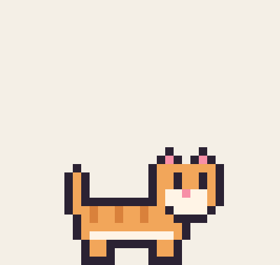
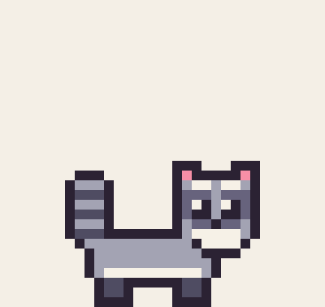

# Desktop Pet 🐱🦝

**A tiny pixel roommate that lives on your Windows taskbar.**

It walks, naps, and judges you a little. It reminds you to stretch and drink water, tells you to go to bed at 2 AM, and throws a confetti party every time you commit code. Choose a calm, sleepy **cat** or a chaotic little **raccoon** who washes its snacks before eating them.

<p align="center">
  
  
</p>

## 📦 Install it (Windows)

1. Go to the [**Releases page**](https://github.com/stryo2/desktop-pet/releases).
2. Under **Assets** of the newest release, download `Desktop.Pet.Setup.<version>.exe`.
3. Run it. In a few seconds your new friend appears on your taskbar, and the app is added to your Start menu and desktop. 🎉

### "Windows is scared of my cat" 🙀

The app isn't code-signed yet (signing costs money and the cat is broke), so Windows is suspicious of it. That's expected:

- **Browser says the file "isn't commonly downloaded":** click **⋯** → **Keep** → **Keep anyway**.
- **Blue "Windows protected your PC" screen:** click **More info** → **Run anyway**.
- **"Smart App Control blocked this app":** sadly there's no way past this one, and please don't turn Smart App Control off just for a cat. If that's you, run it from source (below) until the app is signed.

**Updating:** download the new installer and run it. Your pet keeps its stats, streak and settings.
**Uninstalling (but why 🥺):** Windows **Settings → Apps → Installed apps → Desktop Pet → Uninstall**.
**Mac / Linux:** not yet. The cat is learning.

## 🎮 Playing with your pet

- **Click** to pet it: hearts, purrs, happy face. Click a sleeping pet and it wakes up very startled.
- **Drag** it anywhere and let go. It falls back onto the taskbar, and if you drop it from high up it is *offended*.
- **Right-click** it (or the tray icon) for stats and treats: **Give water**, **Give a treat**, **Play**, **Nap time**, switch **Pet**, **Settings…**, **Bring pet back** (if it wandered off-screen) and **Quit**.
- **Settings** has the pet picker, its size (Tiny → Huge), reminder timers, **Start with Windows** and the git repos it watches. Changes apply right away.

Clicks on the empty space around your pet go straight through to whatever's behind it, so it never gets in your way.

## 🐱 vs 🦝 Choose your fighter

Switch any time from **Settings** or the right-click **Pet** menu. Stats and streak come along.

| | Cat | Raccoon |
|---|---|---|
| Vibe | calm, sweet, professional napper | mischievous, nosy, a little dramatic |
| At night (1–5 AM) | gets sleepy | wide awake and extra playful (still sends *you* to bed) |
| Midday | business as usual | yawns and sneaks naps |
| Hobby | grooming | washing its paws, and its food before eating it |
| Playtime | pounces | rummages around and digs up a treasure (finders keepers) |
| Bonus moves | | stands up to sniff the air, tiptoes around sneakily |

## 💖 Keep it happy

| Stat | Goes down when… | Goes up when… |
|---|---|---|
| ⚡ Energy | it's awake, and faster when it runs around | it naps |
| ❤ Happiness | time passes and nobody pets it | petting, treats, playing |
| 💧 Hydration | time passes | you give it water |

Tired pets yawn and nap a lot. Sad pets sit there looking at you until you pet them. Thirsty pets ask for water, loudly.

When you close the app your pet naps, so its energy refills, but it gets a bit lonely and thirsty while you're gone. It says hi when you come back.

## 🕰️ It reacts to your day

| What you do | What your pet does |
|---|---|
| 50 min of computer use without a break | stretches: "time to stretch! 🧘" (asks again every 10 min if you ignore it 👀) |
| Take a 5+ min break after that | "nice break! ✨" |
| 75 min of computer use | brings a water bowl: "water break? 💧". Click it when you drink and you drink together |
| Step away for 10+ min or lock your PC | falls asleep and greets you when you're back |
| Still up between 1 and 5 AM | "bedtime, human 🌙" every 30 min, looking very sleepy |
| `git commit` | jumps with confetti; your first commit of the day grows your 🔥 streak |
| `git push` | bigger confetti: "pushed! 🚀" |

- Only time you're *actually using* the PC counts toward reminders. Each reminder can be turned off.
- On first run it looks for git repos in `~/projects`, `~/code`, `~/repos`, `~/src`, `~/dev`, `~/git` and `~/Documents/GitHub`. You can add or remove repos in Settings.
- It only *reads* git's own logs: nothing is installed into your repos, and **nothing ever leaves your PC**.
- Your pet's save and settings live in `%APPDATA%\desktop-pet`.

---

## 🛠️ For developers

### Run from source

You'll need [Node.js](https://nodejs.org/) 20+.

```bash
npm install
npm start
```

### Build the installer

```bash
npm run dist
```

This makes `release/Desktop Pet Setup <version>.exe`. Other handy scripts:

| Script | What it does |
|---|---|
| `npm run check-pets` | checks every `pets/*/pet.json` for mistakes |
| `npm run icon` | redraws the app icon from the sprite |
| `npm run demo-gif` | records `docs/demo.gif` (the cat) |
| `npm run demo-gif -- raccoon` | records `docs/raccoon.gif` |

### Publish a release

1. Bump `version` in `package.json` and run `npm run dist`.
2. On GitHub, go to **Releases → Draft a new release**, with tag `v<version>` on `main`.
3. Attach **only** `release/Desktop Pet Setup <version>.exe`, paste the install notes from above, and publish.

### How it's built

It's Electron and TypeScript with no framework: the pet is drawn on a plain `<canvas>`. Fun fact: **the window *is* the pet**. When it walks or falls, the whole (invisible, see-through) window moves. It only catches the mouse when your cursor is over the pet.

| Part | File |
|---|---|
| Window, tray, menu, cursor tracking (Electron main process) | `src/main/main.ts` |
| Loading and validating pets | `src/main/petLoader.ts` |
| Saving state safely | `src/main/save.ts` |
| Idle/away/break/water/late-night detection | `src/main/activity.ts` |
| Watching repos for commits and pushes | `src/main/gitWatcher.ts` |
| Settings (reminders, size, pet, repos) | `src/main/settings.ts` |
| Settings window | `static/settings.html`, `src/settings/settings.ts`, `src/main/settingsPreload.ts` |
| Bridge between page and main process | `src/main/preload.ts` |
| State machine, drawing, mouse, menu actions | `src/renderer/app.ts` |
| Deciding what to do next | `src/renderer/brain.ts` |
| Stats and how they change | `src/renderer/stats.ts` |
| Daily commit streak | `src/renderer/streak.ts` |
| Face overlays, sprite drawing, props | `src/renderer/sprites.ts` |
| Speech bubbles, hearts, Zzz's, confetti | `src/renderer/effects.ts` |
| App icon / demo GIF generators | `scripts/make-icon.js`, `scripts/record-demo.js` |
| Pet art, faces, animations and personality | `pets/<id>/pet.json` |

Set `PET_DEBUG=1` to expose `window.petDebug` in the page for test scripts.

### Add your own pet 🐸🐧🦊

Every pet is one folder with a `pet.json`. You don't need to write any code.

1. Copy `pets/cat` to `pets/<your-pet>`.
2. Edit the `palette` (one character per colour, `.` = transparent) and draw the `frames` as rows of text.
   - Every frame must be exactly `width` × `height` characters.
   - Sprites face **right**; they're mirrored when walking left.
   - Draw poses **without eyes**: each frame's `face: [x, y]` says where the face goes.
3. Add `faces` (`neutral`, `blink`, `happy`, `content`, `sleepy`, `sad`, `surprised`, `love`, `yawn`; `.` keeps the pixel underneath).
4. Add the animations `idle`, `walk`, `sit`, `groom`, `sleep`, `stretch`, `crouch`, `leap`, `eat`, `dragged` and `fall`.
5. Give it a `personality`:
   - how much it likes each action (`weights`), and how that changes at `night` and `midday`
   - its stat `rates` and walking speed
   - everything it says (`lines`)
6. Optional extras: `pets/raccoon` shows the `rummage`, `wash`, `upright` and `sneak` animations, `poses` to swap an animation for a state, and a frame's `hold: [x, y]` for where a found treasure is drawn.
7. Check your work:

```bash
npm run build && npm run check-pets
```

A valid pet shows up in the picker by itself. ✨

## 🗺️ Roadmap

- ~~Walk, drag and click~~ ✅
- ~~Poses, emotions, stats, speech bubbles, saved state~~ ✅
- ~~Reacting to your day: breaks, water, bedtime, naps, git commits~~ ✅
- ~~Settings, start with Windows, installer, demo GIF~~ ✅
- ~~Pet picker and a raccoon with its own personality~~ ✅
- **Next:** code signing, so Windows stops being scared of the cat
- **Someday:** Mac version, accessories you unlock with your streak, Pomodoro mode, friends' pets coming to visit
